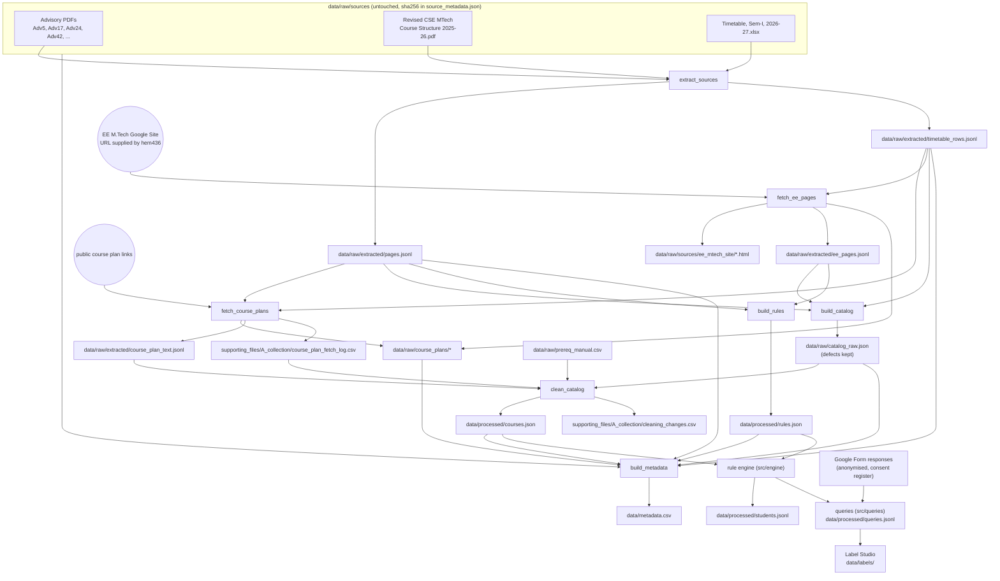

# Data flow

How data moves from the original sources to the processed curriculum files, `data/metadata.csv`, and the later stages.
Each box is a file, each arrow is one command (`.venv/bin/python -m src.collect.<module>`).



Run order for Part A:

```
.venv/bin/python -m src.collect.extract_sources
.venv/bin/python -m src.collect.fetch_course_plans      # add --refresh to download again
.venv/bin/python -m src.collect.fetch_ee_pages          # EE site pages and EE course plans
.venv/bin/python -m src.collect.build_catalog
.venv/bin/python -m src.collect.clean_catalog
.venv/bin/python -m src.collect.build_rules
.venv/bin/python -m src.collect.build_metadata
```

Notes:

- Raw files are never edited. All fixes happen in `clean_catalog`, and each one is a row in `cleaning_changes.csv`.
- `build_rules` stores a verbatim quote for every rule and fails if the quote is not on a page of the cited PDF, so `source_page` cannot drift.
- `fetch_course_plans` reuses earlier downloads unless `--refresh` is given. Failed links are retried on every run.
